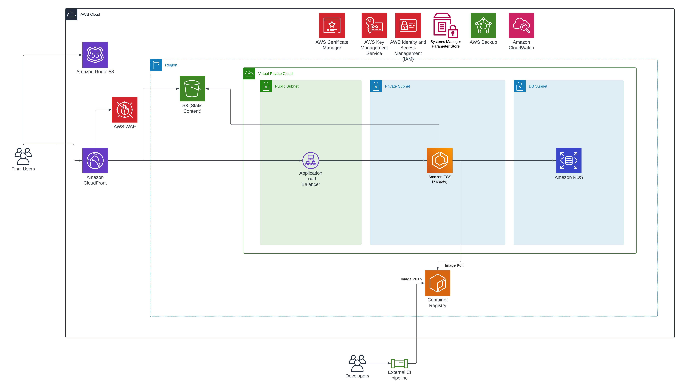

# neosperience-cloud-challenge

## Introduction
A customer is in the process of migrating its actual e-commerce website https://ecommerce.coolsite.com, hosted on a single VPS with Docker, to AWS.
They’re using a containerized Laravel/PHP webapp (container “laravel” listening on TCP 9000) with a nginx proxy in front (container “nginx” listening on TCP 443), and a MySql DB on another dedicated VPS.
Their main concerns at the moment are both scalability to avoid downtime and react fast during sales days (BlackFriday&co), durability & redundancy of all the components.

## Specifications

1. The average resource consumption of both WebApp and DB VPS (2 vCpu / 4GB mem) is 50%
2. A DNS delegation for the ecommerce.coolsite.com domain is already in place pointing to an existing public hosted Route53 zone in the account (id: Z01096296Z8VY2TOSJUX)
3. Certificates for the webapp must be issued and validated through AWS
4. The pipeline to update the application images will be external to AWS (es. Gitlab) and will require user credentials at least to push images to a private ECR repository on the AWS account
5. 2 static storage paths of the application ( /public/uploads and /public/static) must be detached from the web application containers and served through a single CDN (static.ecommerce.coolsite.com)
6. The ecommerce website must be served through a single CDN with default config, except for the /admin/ and /user/ paths 
7. The env variables DB_HOST, DB_USER and DB_PASSWORD must be passed to the “laravel” container in order for the webapp to properly start
8. Every stateful resource must be backuped with a retention of at least 30 days
9. Centralized logging of the webapp must be configured for troubleshooting
10. Redundancy must be configured in a single AWS region
11. “BruteForce” filter to the webApp to block requests from a single IP exceeding the threshold of 5000 requests per 5 minutes, and sending a mail alert to support@coolsite.com when triggered.

## Choices
A list to explain some of the choices made. The list follow the same numeration of the specifications list.

1. The webapp will be hosted on ECS using Fargate, so the sizing will be easy to perform. Instead of using a single large container we can choose a smaller size for it and start scaling the WebApp horizontally on multiple containers. For the MySQL database if the average consumption is confirmed a good choice can be to skip credit based instances and pick something like a graviton instance with compatible resources (for example c6g/c7g). Graviton allows for some more price/performance compared to other brand of silicon. For the applications using MySQL there will be little to none differences.
2. 
3. Certificate Manager will be used for it
4. A set of credentials or better if available on the pipeline provider OpenID Connect can be set up. 
5. Static resources will be stored on S3, if Laravel is used in the backend then support for using external filesystem like for example S3 object storage is already implemented.
CloudFront will be used for every request to the applications, requests to the path where static files are stored will be forwarded to S3.
6. Requests to the WebApp will be cached using default behavior excluding the admin - user paths where caching will be disabled or strongly limited using cookies and query.
7. A secure storage will be used to pass variables to ECS and so to the laravel container.
8. AWS Backup will be used to perform this task. The backup will be tag based and tags will be placed using IaC.
9. AWS Cloudwatch Logs will collect logs from every container and a single centralized access point for debugging will be possible.
10. The ECS cluster will span on multiple AZs inside a single region, RDS database will be set up with multi-az as well.
11. AWS Web Application Firewall will be set up to allow the configurations of firewall rules like rate limiting based on the requests IP. Notification and alarms can be created based on AWS WAF actions.

## IaC and structure
I've chosen Terraform as the main IaC tool as it's the tool I'm more proficient with. 
The project has a structure of multiple terraform components and remote state is used for communications between components.
A simple Makefile is used to simplify the classic terraform operations on each component.

## Test and deploy 
I've successfully deployed and tested the setup using a different domain. 

## Missing points
1. The project being a demo/test is not optimized to be expanded, so I consider this a missing point. Some steps to correct
this can be to enforce a proper structure to avoid having messy IaC when new requirements arise.
2. An alarm to send the email alert when the rate limit is exceeded is not up. The WAF ACL is already set up to publish a metric
so it's just matter of adding the Cloudwatch alarm.
